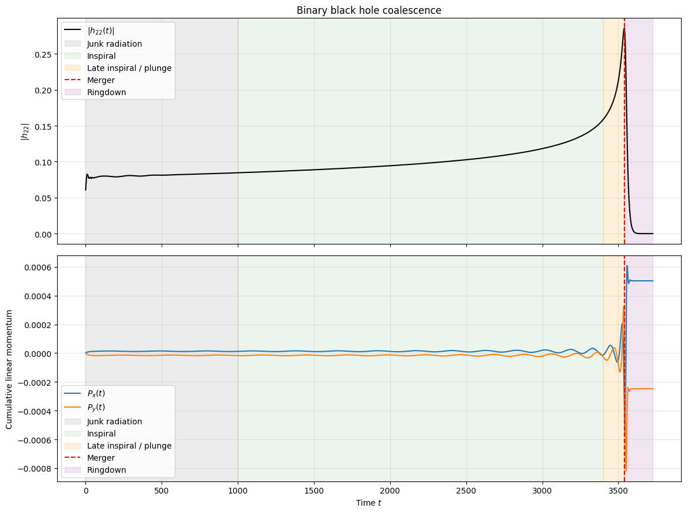
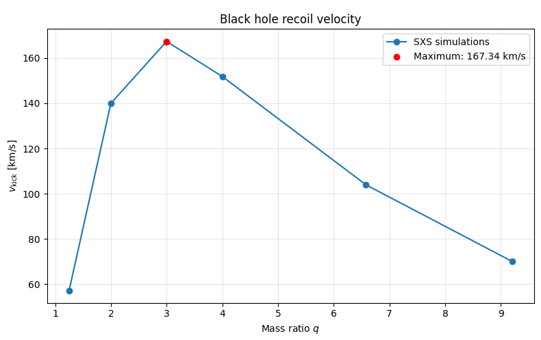
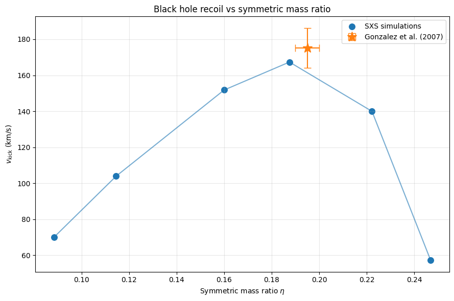

# Black Hole Kicks

Analysis of gravitational-wave modes and black hole recoil velocities using numerical simulations from the **SXS (Simulating eXtreme Spacetimes) catalog**.

## 1. Binary Black Hole Coalescence

The figure illustrates the different stages of a binary black hole coalescence. The upper panel shows the amplitude of the dominant gravitational-wave mode, $|h_{22}(t)|$, while the lower panel displays the cumulative linear momentum components, $P_x(t)$ and $P_y(t)$.

The stages of the evolution are highlighted: junk radiation, inspiral, late inspiral/plunge, merger, and ringdown.



## 2. Recoil Velocity as a Function of Mass Ratio

The recoil velocity is computed for six SXS simulations by integrating the gravitational-wave linear momentum flux from $t=1000$ to the end of each waveform, excluding the initial contribution from junk radiation.

The maximum recoil velocity obtained is approximately

$$
v_{\mathrm{kick}}^{\max}\approx167.34\ \mathrm{km/s},
$$

corresponding to a mass ratio of $q\approx3\$.



## 3. Comparison with González et al. (2007)

To compare our results with González et al. (2007), we use the symmetric mass ratio,

$$
\eta=\frac{q}{(1+q)^2}.
$$

The orange star indicates the maximum recoil velocity reported by González et al. (2007): $175.2\pm11\ \mathrm{km/s}$, at $\eta=0.195\pm0.005$.



## Files

- [`SXS_Black_Hole_Kicks.ipynb`](SXS_Black_Hole_Kicks.ipynb): Complete computational notebook.
- `figures/`: Figures generated from the analysis.

## Libraries and Dependencies

The analysis was developed in Python using the following libraries:

- **NumPy:** Numerical operations, array manipulation, and numerical integration.
- **Matplotlib:** Visualization of gravitational-wave modes, momentum flux, and recoil velocities.
- **Pandas:** Organization and analysis of simulation results.
- **SXS:** Access to numerical relativity simulations from the Simulating eXtreme Spacetimes catalog.

### Installation

The required packages can be installed using:

```python
pip install numpy matplotlib pandas sxs
```
