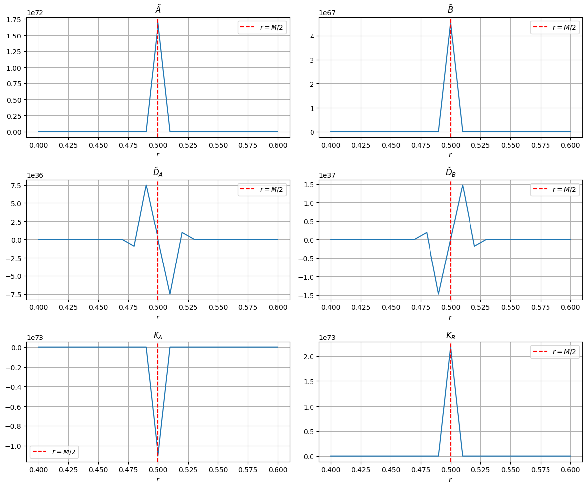
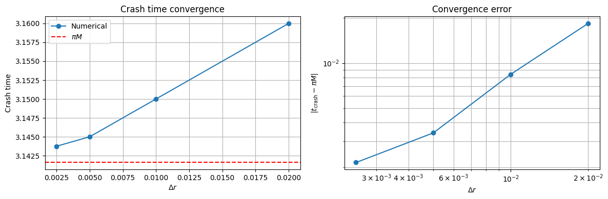

# Numerical ADM Evolution of Black Holes

This project explores the numerical evolution of a spherically symmetric Schwarzschild black hole using the ADM (Arnowitt–Deser–Misner) formulation.

The implementation combines finite-difference methods, the fourth-order Runge–Kutta (RK4) integrator, and the method of lines to solve the evolution equations.

## Contents

1. **Finite Differences:** Implementation of fourth-order finite-difference operators, including boundary treatment using ghost points.
2. **Runge–Kutta (RK4):** Implementation and testing of a fourth-order time integration scheme.
3. **Method of Lines:** Numerical solution of the one-dimensional advection equation.
4. **ADM Evolution of a Schwarzschild Black Hole:** Numerical evolution using spherically symmetric ADM equations and isotropic initial data.

## ADM Evolution: Numerical Results

### ADM Variables near the Horizon

The radial profiles show the behavior of the evolved ADM variables near $r=M/2$, where the numerical evolution develops a strong divergence.

The large peaks indicate that the evolved variables develop increasingly sharp and divergent profiles near the horizon, signaling the breakdown of the numerical evolution.

### Crash-Time Convergence

The evolution was repeated at different spatial resolutions to investigate the behavior of the numerical crash time. As the grid spacing decreases, the crash time approaches a finite value:

$$
t_{\mathrm{crash}}\longrightarrow \pi M. 
$$

This indicates that the crash is not eliminated by refining the numerical grid, but instead approaches a finite-time limit in the chosen ADM evolution.

